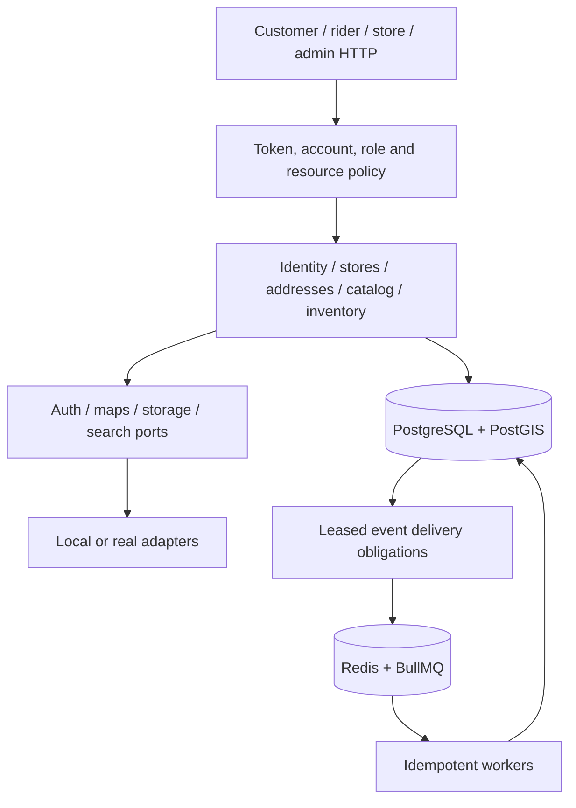

# Implemented architecture: P0–P4

The backend is a modular NestJS/Fastify application with one image and six runtime roles. A single audience composition registry drives both route loading and per-audience OpenAPI generation, preventing documentation and runtime routes from drifting apart.

`domain/` contains pure policy, schedule and value calculations; `application/` contains use cases behind contracts; `infrastructure/` owns SQL and external I/O. Cross-module imports use contracts, with explicit exceptions for Nest module wiring. CI resolves TypeScript imports to enforce this rule. Several identity operations still combine transaction orchestration and persistence in small infrastructure services; the phase implementation does not claim every SQL-bearing service has a separate repository abstraction.

PostgreSQL owns account status/roles, addresses, capacity, state histories, idempotency tombstones and event completion. Redis owns disposable caches/rate limits and job transport. Losing an enqueued Redis job does not complete its durable delivery obligation. The relay can republish it; consumer effects and dedupe commit together.

Workers are enabled only on `all`/`worker`. Identity synchronization preserves per-user operation ordering, reconciles ambiguous provisioning, retries compensation and calls providers outside database transactions. Store availability polling catches up from durable signals. Generic concern queues support bounded concurrency, retry/DLQ replay and IST job schedulers.

Serviceability uses PostGIS `ST_Covers`, explicit zone priority and distance; external maps do not decide zone membership. Catalog resolves the store from an owned address, then joins publication, current temporal prices and eligible batch availability. SearchPort shares the existing PostgreSQL query provider. Suggestion caches use revisions and upcoming price/shelf-life boundaries.

Inventory serializes operation/reservation, sorted stock and batch locks. Every movement has a retained reference and immutable ledger entry; on-hand/reserved reconcile with batches. HELD payment holds expire, COMMITTED allocations survive, and picks/shorts resolve once. Expired or damaged allocated stock is reallocated or produces a durable obligation for later commerce/fulfillment compensation.

Imports use BullMQ hints backed by durable jobs, leases and batch checkpoints; database scans recover lost Redis jobs. Media promotion and private report writes record cleanup intents before external I/O and fence cleanup against registration. The existing image runs imports/media/inventory maintenance only on `all`/`worker`. Orders, payments and fulfillment remain P6–P8 work.

See the [implementation plan](IMPLEMENTATION_PLAN.md) for the target architecture and the [progress record](PROGRESS.md) for acceptance evidence and remaining provider checks.
