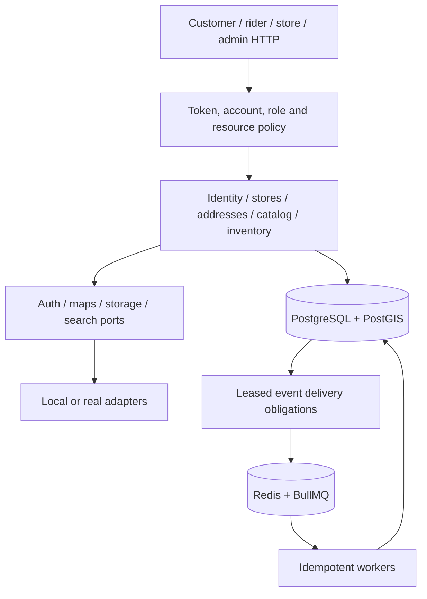

# Working-tree architecture: P0–P12

The backend is a modular NestJS/Fastify application with one image and six runtime roles. A single audience composition registry drives both route loading and per-audience OpenAPI generation, preventing documentation and runtime routes from drifting apart.

`domain/` contains pure policy, schedule and value calculations; `application/` contains use cases behind contracts; `infrastructure/` owns SQL and external I/O. Cross-module imports use contracts, with explicit exceptions for Nest module wiring. CI resolves TypeScript imports to enforce this rule. Several identity operations still combine transaction orchestration and persistence in small infrastructure services; the phase implementation does not claim every SQL-bearing service has a separate repository abstraction.

PostgreSQL owns account status/roles, addresses, capacity, state histories, idempotency tombstones and event completion. Redis owns disposable caches/rate limits and job transport. Losing an enqueued Redis job does not complete its durable delivery obligation. The relay can republish it; consumer effects and dedupe commit together.

Workers are enabled only on `all`/`worker`. Identity synchronization preserves per-user operation ordering, reconciles ambiguous provisioning, retries compensation and calls providers outside database transactions. Store availability polling catches up from durable signals. Generic concern queues support bounded concurrency, retry/DLQ replay and IST job schedulers.

Serviceability uses PostGIS `ST_Covers`, explicit zone priority and distance; external maps do not decide zone membership. Catalog resolves the store from an owned address, then joins publication, current temporal prices and eligible batch availability. SearchPort shares the existing PostgreSQL query provider. Suggestion caches use revisions and upcoming price/shelf-life boundaries.

Inventory serializes operation/reservation, sorted stock and batch locks. Every movement has a retained reference and immutable ledger entry; on-hand/reserved reconcile with batches. HELD payment holds expire, COMMITTED allocations survive, and picks/shorts resolve once. Expired or damaged allocated stock is reallocated or produces a durable obligation for later commerce/fulfillment compensation.

Imports use BullMQ hints backed by durable jobs, leases and batch checkpoints; database scans recover lost Redis jobs. Media promotion and private report writes record cleanup intents before external I/O and fence cleanup against registration. Background commerce, fulfillment, subscription and compliance work runs only on `all`/`worker`.

See the [implementation plan](IMPLEMENTATION_PLAN.md) for the target architecture and the [progress record](PROGRESS.md) for acceptance evidence and remaining provider checks.

## Commerce and fulfillment integration

Checkout commits the cart intent, current quote validation, capacity/coupon/stock obligations, wallet debit and frozen order together. Gateway setup runs after commit. Verified capture receipts feed the orders consumer; terminal or excess captures reserve refunds rather than funding the order twice. Refund dispatch commits UNKNOWN before external I/O and fences concurrent outcomes with a nonblocking session advisory lock. No gateway call runs inside a database transaction.

Picking consumes the actual scanned batches and stores final quantity/discount/tax/substitution snapshots in the order transaction. Packing emits ORDER_PACKED. Dispatch binds its custody transitions to orders; failed deliveries retain custody until a full store return enters quarantine and compensation reserves refunds. Invoice numbering locks the delivered order and entity/year counter together.

Workers publish realtime messages through Redis. Audience instances forward each publication only to their local sockets; reconnect snapshots and HTTP reads remain authoritative. Notification deliveries use durable leases and per-device results; only promotional messages observe preferences and quiet hours.

Subscriptions own effective-dated schedules and unique dated occurrences. Scheduled checkout uses the same wallet, stock, capacity and order contracts as ordinary purchasing. The account lock precedes subscription/order obligations; the slot controls picking and dispatch release independently of nighttime generation. Support, ratings and payouts use the delivered-order and rider-accounting records. Payout offsets and approved corrections are distinct from actual COD deposits and manual payment evidence.

Store-scoped subscription workers first commit short `SKIP LOCKED` lease claims, then revalidate their tokens under the account and subscription locks. Expiry recovers abandoned claims; a shared limit bounds concurrent business transactions. Scheduled pricing batches configuration reads, and serviceability uses the caller's database transaction through availability and rider-signal checks. Transactional zone reads bypass shared caching so rollback cannot publish uncommitted routing state.

Compliance coordinates domain-owned obligation and privacy contracts. Erasure blocks new obligations with the account lock, revokes local access before provider/object cleanup, and keeps restricted deleted-identity tombstones plus immutable legal/accounting references. Reports use bounded repeatable-read attempts, spool CSV before external upload, and fence private-object finalization against lease loss or erasure. PostgreSQL remains the recovery authority when Redis jobs disappear. Completion and test limits are recorded in PROGRESS.md.
