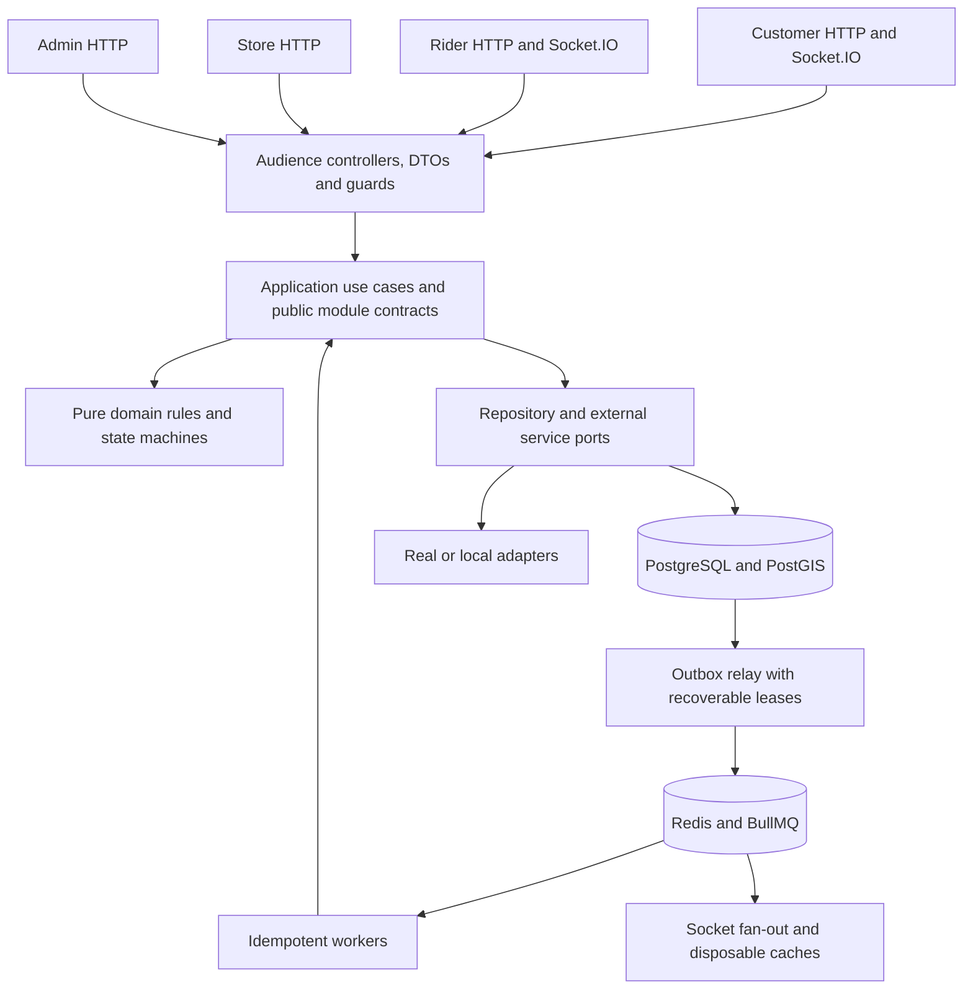

# Delivery platform implementation plan

Prepared: 6 November 2026. Status: P0–P2 implementation and cleanup reviewed; local acceptance evidence and external checks are recorded in [PROGRESS.md](PROGRESS.md).

Source: [delivery-platform-agent-prompt.md](../delivery-platform-agent-prompt.md), version 1.0. This plan preserves its full backend scope and P0–P13 acceptance sequence. The owner explicitly authorized parallel implementation with one phase per subagent; acceptance remains ordered by dependency. Decisions below resolve contradictions or fill implementation gaps and become ADRs before dependent work. Actual completion evidence belongs in PROGRESS.md.

## 1. Intended outcome

Build the specified NestJS/Fastify modular monolith: four isolated API surfaces, background workers, and customer/rider Socket.IO gateways. Quick commerce, subscriptions, store operations, money movements, and administration must work locally without third-party credentials. Production adapters must also be implemented and contract-tested.

Use the existing workspace as the repository root. Keep the master specification as the requirements reference. Do not create an extra nested `delivery-platform/` directory. AWS provisioning, frontends, restaurant flows, ML, SMS login, and automated bank payouts remain outside scope.

Deliver five demonstrable milestones:

| Milestone | Phases | Demonstration |
|---|---|---|
| M1: usable platform foundation | P0–P3 | Start locally, obtain audience-specific tokens, resolve a store, manage addresses, browse/search its published catalog. |
| M2: correct purchasing | P4–P6 | Reserve stock, apply coupons/wallet, place/pay/cancel/refund an order, reconcile a fake gateway, prove concurrency invariants. |
| M3: complete delivery | P7–P9 | Pick/pack, dispatch, track, deliver, record COD/earnings, issue an invoice, receive deduplicated notifications. |
| M4: full business scope | P10–P12 | Generate subscription deliveries, handle support/ratings/payout records, complete administration and exports. |
| M5: verified handoff | P13 | Pass security, resilience, migration, load, and complete edge-case gates; produce operational documentation. |

Calendar commitments should follow the P0 compatibility spike and measured slice throughput. M2 is the main correctness checkpoint; M3 is the first complete delivery journey. Neither is a substitute for the full deliverable.

## 2. Execution rules and completion evidence

Implement one vertical slice at a time: contract and permissions → migration/constraints → domain rules → application transaction → repositories/adapters → audience controllers → workers/events → relevant tests → documentation. Do not build all controllers first and defer transaction rules.

Every phase requires:

1. The preceding phase's checks remain green.
2. Lint, module boundaries, typecheck, unit, integration, concurrency/idempotency, migration, and relevant API/adapter suites pass.
3. Newly exported OpenAPI operations and socket events match their approved contracts.
4. New settings, events, indexes, permissions, and dependencies are documented.
5. Relevant rows in [EDGE_CASES.md](EDGE_CASES.md) link to real tests with assertions, not empty files or skipped tests.
6. [PROGRESS.md](PROGRESS.md) records completion evidence, assumptions, remaining gaps, and the next slice.
7. Conventional Commits record small slices when a writable Git repository is available. A normal repository is now initialized on `main`; the earlier protected placeholder was absent after the environment permissions changed.

Required implementation scripts: `dev`, `start:dev`, `build`, `lint`, `typecheck`, `test`, `test:int`, `test:conc`, `test:e2e`, `test:adapters`, `test:migrations`, `migrate`, `migrate:down`, `seed`, `openapi:export`, and `k6:*`. `dev` and `start:dev` are aliases. `migrate:down` is restricted to development/test; production corrections use forward migrations.

## 3. Decisions to settle before dependent work

The choices in this section are implementation decisions for this plan. Domain-specific sections of the master specification take precedence over conflicting shorthand in its tables. Record each decision with context, consequences, and the tests that enforce it.

| ID / owner phase | Issue in the specification | Planned decision |
|---|---|---|
| D01 / P0 | “Latest” dependencies are moving targets. | At P0, verify official stable releases and peer dependencies, pin exact versions and container digests, commit the lockfile, and record the compatibility matrix. Node 26 is the current Active LTS line according to the [Node release schedule](https://github.com/nodejs/Release); recheck the exact patch when implementing. |
| D02 / P0 | Nest-generated Swagger output is assumed to be OpenAPI 3.1. | Explicitly select 3.1 and validate the complete generated schema, including nullability and money fields. A version string alone is insufficient. The [Nest document builder](https://github.com/nestjs/swagger/blob/master/lib/document-builder.ts) is the integration point; P0 proves the installed version's behavior. |
| D03 / P0 | Money is `bigint`, but JSON has no bigint value type. | PostgreSQL `bigint` ↔ TypeScript `bigint` ↔ decimal strings in API/event JSON, e.g. `totalPaise: "49900"`. Reject decimals, negatives where prohibited, and overflow. Convert to gateway SDK numbers only after a safe-integer range check. |
| D04 / P0 | Module imports and multi-module transactions need a composition rule. | Composition roots and wiring-only feature modules may import provider-only Nest modules and their explicit exports; sibling imports in a root alone do not make providers visible to each other. Controllers remain in audience modules. All business collaboration uses `contracts/`. A transaction contract lets synchronous calls share one DB transaction without exposing Kysely to domain rules. |
| D05 / P0 | Relay publication conflicts with “no external calls inside transactions.” | Claim outbox rows with a lease in a short transaction; commit, publish to Redis, then acknowledge in another transaction. Recover expired leases. Delivery is at least once; local business effects are deduplicated transactionally. |
| D06 / P0 | Worker health wording and webhook routing are incomplete. | Workers expose internal `/healthz`, `/readyz`, and protected `/metrics` only. Payment webhooks are registered by `customer`/`all`; customer sockets by `customer`/`all`, rider sockets by `rider`/`all`. Other roles expose neither audience's routes. |
| D07 / P1 | `users.email UNIQUE` conflicts with the same email in both pools. | Uniqueness is `(pool, normalized_email)` and `(pool, cognito_sub)`. Never merge customer and workforce accounts by email. |
| D08 / P1 | Bootstrap and onboarding cannot pass the usual active-profile/approved-rider guards. | Explicit route policies allow verified customer bootstrap before a local profile and pending riders' own onboarding endpoints. Approval is mandatory for rider online/operational endpoints. The default remains deny. |
| D09 / P1 | Stale JWT groups can retain a removed role. | Verify pool/client/token use, then intersect claims with current local permissions. Check account/authorization versions; money/admin operations read authoritative DB state. Cache invalidation is an optimization, not the sole revocation guarantee. [Cognito token verification](https://docs.aws.amazon.com/cognito/latest/developerguide/amazon-cognito-user-pools-using-tokens-verifying-a-jwt.html) distinguishes access-token `client_id` from ID-token `aud`. |
| D10 / P1 | Maker-checker and private uploads are scheduled later than their first uses. | Build the shared maker-checker executor, audit/config primitives, and private upload contract in P1. Add policies in P3/P4/P6 and payout workflows in P11. Local and real storage adapters are complete by P3. |
| D11 / P2 | Capacity and the default address have cross-request invariants. | Enforce checkout capacity with locked store/time-bucket counters, and exactly one default among a user's nondeleted addresses through a user/address transaction plus a partial unique index. A partial index alone enforces only “at most one.” |
| D12 / P4 | Payment confirmation “commits” stock, while picking consumes it. | `HELD` reservations expire while awaiting payment. Confirmation changes them to `COMMITTED` and removes payment expiry; stock stays reserved. Picking decrements both on-hand and reserved for actual quantities, releases shorts, and records consumed/released quantities. Sweeps never release a confirmed reservation. |
| D13 / P4 | Perishable sellable stock and substitutions need more than aggregate counts. | Track eligible, quarantined, damaged, expired, and allocated batch quantities and validate shelf life at the target delivery slot. If confirmed stock expires or is damaged, lock the affected orders/stock/batches, reallocate eligible FEFO stock or short/cancel and compensate, then write off unallocated quantities without violating reserved≤on-hand. Substitution atomically reserves replacement/releases original and caps customer charges. |
| D14 / P5 | Inclusive GST can be added twice by a naive quote pipeline. | Line amounts and configured gross fees already include their applicable tax. Extract tax for disclosure; do not add it again. Snapshot tax/fee/config versions. An example fixture must prove that an inclusive ₹105 line at a configured 5% rate totals ₹105 and discloses ₹5 tax. This is an arithmetic fixture, not a tax-rate recommendation. |
| D15 / P5 | Pricing and coupon state can change between quote and checkout; different keys can duplicate one cart submission. | Persist an expiring quote snapshot/fingerprint. Atomically consume a cart-version checkout intent with a unique placement reference, even if two tabs supply different idempotency keys; require a new intent/version for an intentional second purchase. Validate all commercial versions and reserve global/per-user coupon quota in the placement transaction. |
| D16 / P6 | One wallet debit can span cash and promo, but the proposed unique key cannot represent both. | Ledger uniqueness includes account and bucket as well as reference/reason. Store funding and refund allocations; reversals restore the original buckets once. Track expiring promo credit lots. Refund processing includes pending refund commitments in the available-refund calculation. |
| D17 / P6 | External calls can time out after succeeding; local dedupe alone cannot prevent duplicate vendor actions. | Persist a stable operation/receipt correlation before calling. Contract-test the provider's real lookup/webhook matching path, including lost create responses; unmatched/multiple results remain UNKNOWN with bounded escalation/manual review and no speculative recreation. Use documented [`X-Refund-Idempotency`](https://github.com/razorpay/markdown-docs/blob/master/api/refunds/normal-refunds-idempotent.md) for refunds. Never switch an ambiguous provider refund to wallet until its original outcome is definitively resolved. |
| D18 / P6 | Failed→captured events and multiple external captures exceed the simplified payment machine. | Model attempts separately from order funding. A verified capture may supersede an earlier failure only if funding remains valid; if wallet funding was reversed, atomically reacquire every obligation or refund the late capture. Stale failure events cannot undo capture. One canonical receipt funds the order and extra receipts are refunded. External duplicate capture cannot be ruled out locally. |
| D19 / P6 | “Invoice drafted at confirmation” conflicts with “issued at delivery”; P7 requests a credit note before issuance. | Confirmation may create an unnumbered draft. Issue the numbered immutable invoice only after delivery using fulfilled quantities. Pre-invoice shorts adjust the future invoice and trigger refunds; post-invoice reductions generate credit notes. Increment the `(legal_entity, financial_year)` counter and insert the document in one transaction. [PostgreSQL sequences are not gapless](https://www.postgresql.org/docs/16/functions-sequence.html). |
| D20 / P6 | A four-digit code stored only as a hash cannot be shown again after restart. | Derive the code with a versioned secret and order-specific nonce; store its HMAC verifier and key version at confirmation, never plaintext. The later delivery task references that code. Re-derive only for authorized customer delivery-code reads. Keep derivation and verification secrets separate, support key rotation, and persist attempt limits. |
| D21 / P8 | “Reassign suspended riders” conflicts with “never auto-reassign after pickup.” | Before pickup, suspend/unassign/re-dispatch. After pickup, keep custody attached to the original rider and escalate for an audited recovery/RTO procedure. A status change must never imply that another rider physically has the parcel. |
| D22 / P8 | Redis GEO members do not inherit per-rider hash TTL; socket Pub/Sub does not replay missed packets. | Filter every candidate by fresh rider state and prune stale GEO members. Use authorized snapshots and aggregate versions on reconnect. The selected [Socket.IO Redis adapter does not support connection-state recovery](https://socket.io/docs/v4/redis-adapter/); HTTP polling remains required. |
| D23 / P10 | Cutoff examples, generation timing, and subscription terminal statuses are inconsistent. | For delivery date D, cutoff is D−1 at the configured IST time; `< cutoff` is editable, `>= cutoff` applies to the next eligible date. A new subscription after today's cutoff cannot promise tomorrow. Generation runs after cutoff, evaluates store opening at the target slot, and adds `COMPLETED` for an elapsed end date. |
| D24 / P0–P13 | Fixed env keys omit required secrets, endpoint paths, and operational limits. | Preserve every listed key, add documented infrastructure/security keys through an ADR, and keep business tunables in typed `app_config`. Production validates only selected real-provider requirements and rejects local endpoints, placeholder secrets, fake adapters, and Razorpay test keys. Disabled SMS/call masking are permitted capability states. |
| D25 / P6–P12 | `force-state` and fraud rules could bypass safety invariants. | Force-state uses guarded repair commands, maker-checker, a reason, and `SUPER_ADMIN`; it never writes an arbitrary status or bypasses accounting. Fraud flags are advisory until an explicitly configured and audited decision is made. |
| D26 / P3 | Catalog eligibility requires inventory rows before the P4 inventory feature phase. | Introduce the inventory-owned `store_inventory` structure and public availability query in P3, with zero-quantity assortment rows. P3 can display out-of-stock products. P4 adds mutations, batches and ledgers; nonzero seed stock then enters through receipts. |

## 4. Architecture and ownership

Retain the source's `contracts/domain/application/infrastructure` module structure. Domain and application rules must be testable without a Nest application. Surface code contains transport concerns; repositories contain persistence concerns; adapters contain vendor translation only.

| Owner | Modules/data it owns | Synchronous contracts | Events/asynchronous effects |
|---|---|---|---|
| Identity and policy | identity, audit, app-config, consent, maker-checker | Principal/permission checks, current settings, approvals | Block/role changes, erasure workflow, review notifications |
| Store and location | stores, addresses, serviceability | Resolve store, snapshot address/zone, claim capacity | Store/zone changes, auto-pause, cache invalidation |
| Merchandising | catalog, pricing, coupons, media/search adapters | Published variants, quote, reserve/release coupon quota | Index/cache refresh, imports, bulk approvals |
| Stock | inventory and batches | Reserve, confirm, consume, release, QC/restock in caller transaction | Low-stock, expiry, adjustments, sweeper work |
| Commerce | cart, checkout, orders, wallet, payments, invoicing | Place/transition/cancel order, debit/reverse funds | Gateway operations, reconciliation, invoices, fulfillment triggers |
| Store fulfillment | picking | Claim/start/pick/complete/pack/handover | Dispatch trigger, shorts, SLA breaches, RTO intake |
| Last mile | riders, dispatch, tracking, earnings | Assignment, custody transitions, COD/delivery validation | Offers, locations, ETA, earnings, payout preparation |
| Retention and operations | subscriptions, notifications, support, ratings, compliance | Due-date calculation, generation, scoped support actions | Scheduled orders, messages, exports/erasure, reports |

Use synchronous contracts sharing one transaction for stock, coupon, wallet, capacity, order, and state-history invariants. Use events for work that can occur after commit: task creation, dispatch, notifications, invoice rendering, reconciliation, search refresh, and reporting. A missing pick/delivery task after confirmation must be recoverable by its idempotent consumer and a repair scan.

Customer order reads and rider/store task lists use public query contracts or explicit owner-approved read projections; they must not reach into another module's repository. Infrastructure roles have least-privilege DB grants; migration credentials are separate from runtime credentials.

## 5. Transaction, event, and recovery design

### 5.1 Locking and state transitions

Before P4, document a shared lock hierarchy and assert it in concurrency tests. Start with subscription → order/payment aggregate → capacity bucket → coupon/user quota → wallet → sorted `(store_id, variant_id)` stock rows → sorted batch rows → pick/delivery tasks → rider status → invoice counter. Within each class sort IDs. A command that needs an earlier class must acquire it before later classes; it cannot call back into an earlier locking contract. Read IDs without locks, then acquire/revalidate in hierarchy order.

Subscription generation claims the subscription before creating its new order. Dispatch accept/cancel/handover acquire the order before delivery-task/rider locks. Work claiming is separate from executing business mutations, so a claimed job/task lock does not reverse the hierarchy. Every conditional update is rechecked after locking.

Use short transactions and bounded retries for PostgreSQL serialization/deadlock errors only. A retried transaction contains no third-party calls and no observable side effects before commit. Sample `clock_timestamp()` once after acquiring relevant locks for critical expiry/cutoff decisions; transaction-start `now()` can be stale after a lock wait. Pure rules receive the sampled time through the injected `Clock` abstraction. Test a request blocked across a cutoff/offer-expiry boundary.

### 5.2 HTTP idempotency

Scope the unique key by actor, audience, HTTP method, route/resource, and key. Hash normalized validated input and relevant path parameters. Guards and resource authorization run before replay.

Persist the business operation reference and its initial outcome in the same transaction as the mutation. Complete the response record durably; replay the exact completed status/body. If the process dies while gateway setup is pending, recovery resumes that operation and order rather than placing another order. Use leases/fencing for abandoned in-flight records. Expired leases must not permit concurrent execution of a still-running transaction.

Same key/different hash returns `IDEMPOTENCY_KEY_REUSED`; a currently owned operation returns `REQUEST_IN_PROGRESS`. Retain a compact unique scope/key/request-hash/original-operation tombstone after the 24-hour response cache expires. Rebuild/reference the original operation or reject expired response replay; never execute placement again because its cached response was pruned. Independent business references remain unique as well.

### 5.3 Outbox and jobs

Event envelope: `eventId`, `eventType`, `schemaVersion`, `aggregateType`, `aggregateId`, `aggregateVersion`, `occurredAt`, `correlationId`, `causationId`, and payload. Include identifiers and necessary snapshots; exclude delivery codes, credentials, and unnecessary PII.

Add outbox lease/token/retry scheduling fields and per-consumer delivery bookkeeping. One event may fan out to several queues; partial fan-out failure must not mark every consumer delivered. Keep each obligation until the business effect completes, independently of enqueue acknowledgement. Recovery republishes uncompleted obligations even if a previously acknowledged job was subsequently lost from Redis; lease acknowledgements are token-fenced. A deterministic job ID is an optimization, not the correctness mechanism.

For DB effects, insert `processed_events(consumer,event_id)` and apply the effect in one transaction; failure rolls both back. For external effects, write a durable operation/delivery record in that transaction, then execute the adapter after commit. Ignore stale aggregate updates only according to that handler's state rules; do not discard independent refund/ledger events solely because they arrive late.

Jobs use stable scheduler IDs, bounded concurrency, backoff/jitter, timeouts, failed-job metadata, and replay through the same idempotent handler. Consumer dedupe retention must exceed the permitted replay window; permanent business references remain unique even after dedupe cleanup. A recovery scan must recreate missing BullMQ work from durable DB records after Redis data loss.

### 5.4 Purchasing and payment saga

1. Verify active customer, consent, email verification, idempotency key, and cart/quote versions.
2. In one transaction, revalidate prices/config/coupon, target store/zone/capacity and account status; reserve capacity, coupon quota, wallet allocation and stock; freeze order/items/fees/address; create a durable gateway operation, histories, and outbox events.
3. Commit. For a gateway-funded order, create its payment order outside the transaction. On a known failure expose the existing order plus retry instructions; on an ambiguous timeout reconcile before another attempt. COD and fully funded orders confirm without a gateway call.
4. Verify webhook signature over exact raw bytes. Persist a unique provider/event ID plus body hash and durable processing work before returning 200. Invalid signatures do not create business events; the same event ID with a different signed body is rejected/alerted rather than silently replayed.
5. Under the order/payment lock, validate authoritative amount/currency and existing funding; confirm stock/coupon and order once. Default late success is refunded. If `reinstate_expired_orders` is enabled, only system-expired orders qualify: atomically revalidate/reacquire account eligibility, commercial policy, stock, capacity, coupon and wallet obligations, then confirm; refund if any requirement fails. A customer-cancelled order is never silently reinstated. Refund any additional receipt after an order is already funded.
6. Expiry/cancel workers use the same transition/compensation contracts. Reverse the wallet allocation once, release only outstanding stock/coupon/capacity obligations, and reserve any external refund amount before initiating it.
7. Poll pending/unknown operations, including expired orders with unresolved attempts, so a late capture with a missed webhook is still found. Nightly reconciliation reports differences without speculative money changes.

Webhook ingress must remain writable even when Redis is down: the DB inbox/outbox retains processing work for the relay. The client verify endpoint validates its signature and fetches authoritative payment status; it never marks an order paid from client claims alone.

### 5.5 Fulfillment, refunds, and cancellation

Keep original commercial snapshots immutable and record fulfillment adjustments separately. Picking resolves each item/batch and determines final fulfilled amounts, discounts, fees, tax disclosures, and refunds under the frozen policy. Fulfillment cannot increase the customer's charge without an explicit future product flow.

Before pickup, cancellation atomically marks the order and adjusts local obligations; durable effects cancel tasks/revoke offers and request refunds. After pickup, use delivery-failure/RTO and custody records. A refund allocation must never both restore wallet spending and independently credit that same spending again.

Refundable funding is defined per actually paid source: gateway capture, net wallet debit, and verified COD collection. `COD_PENDING` and a zero-due order do not create captured cash. Pending and successful refund commitments reserve each source's cap. Keep commitments reserved through UNKNOWN outcomes; cross-destination fallback requires authoritative terminal failure of the original operation, an atomic destination change and continued reconciliation of contradictory late evidence.

Gapless document issuance locks the legal-entity/FY counter, increments it, inserts the immutable payload, and commits together. Render/upload afterward; failed rendering retries the same invoice number. Credit notes reference the affected issued document. Test rollback and financial-year rollover at IST midnight.

### 5.6 Subscription generation

Persist a store/date generation run and per-subscription outcome. Lock a due subscription, evaluate its effective schedule/cutoff/skip/address and target slot, insert the unique `(subscription_id, delivery_date)` occurrence, then create the wallet-funded order through the shared checkout contract in the same transaction. A duplicate occurrence cannot debit a wallet or reserve stock again.

Occurrences have a locked `PENDING → RETRYABLE → ORDERED | SKIPPED` lifecycle. Grace retries reuse the same occurrence row rather than being suppressed by `ON CONFLICT DO NOTHING`; the state transition and order/debit/reservation commit together. A retry after the grace deadline cannot revive a terminal skipped occurrence.

Evaluate capacity/open hours for the delivery slot, not the nighttime generation instant. Confirmed subscription reservations survive the ordinary quick-commerce payment window. Failures are isolated per subscription; retryable low balance has a bounded grace window, durable notifications, and a terminal skipped outcome. Pause/cancel mutations compensate eligible generated orders under the same cutoff rules.

## 6. Schema and configuration work

### 6.1 Migration strategy

Create schema incrementally with the owning phase. Each migration declares owning module, supported previous version, relevant query indexes, rollback/recovery notes, and transaction requirements. Plain SQL migrations are run by `node-pg-migrate`; P0 verifies the installed stable version's [SQL migration format](https://salsita.github.io/node-pg-migrate/migrations/). Do not introduce a second migrator.

| Phase | Schema groups and extra constraints |
|---|---|
| P0 | Extensions; timestamps/version conventions; idempotency; outbox/deliveries; consumer inbox; durable operations; schema history. |
| P1 | Users, profiles, roles, consents, audit, typed settings/flags, maker-checker requests/executions, identity provisioning operations; rider approval skeleton. |
| P2 | Legal entities/cities, stores/hours/holidays/zones, addresses/contact fields, store-staff assignments, store/time capacity buckets; add deferred store FKs to P1 models. |
| P3 | Catalog/variants/media, prices/history, synonyms, import jobs/checkpoints, substitution candidates, inventory-owned zero-stock assortment structure; prevent overlapping active price windows with transactional validation/constraints. |
| P4 | Extend inventory with batches/reservations/ledger, receipt/adjustment/cycle-count/QC records; add the order reservation FK when P6 introduces orders. |
| P5 | Carts/items, quote snapshots, coupons/global counters, per-user quota counters, redemptions; add order FKs in P6. |
| P6 | Wallet accounts/ledger/promo lots/funding allocations; orders/items/histories/adjustments and delivery-code verifiers; gateway attempts/inbox/refunds/refund allocations/reconciliation; COD financial records; invoice counters/documents. |
| P7 | Pick tasks/items/history, staff shifts, packing/handover records, batch allocations, RTO/QC workflow. |
| P8 | Rider documents/shifts/status, delivery tasks/offers/assignment history and code-attempt tracking, partitioned GPS history, earnings/cash ledger. |
| P9 | Templates, device tokens, preferences, inbox entries, per-channel delivery attempts and dedupe. |
| P10 | Plans/slots, subscriptions/effective schedule versions, pauses/skips, unique dated occurrences, generation runs/items. |
| P11–P12 | Tickets/messages/ratings/aggregates, payout batches/items, export jobs, erasure/export requests, retention and fraud-review records. |

P4/P5 can temporarily hold generated order UUID references without a foreign key because checkout is not exposed yet. P6 validates and adds those FKs before accepting orders. Do not invent placeholder order rows. Immutable ledger/audit/event tables keep timestamps but have no mutable update path. Grants or database guards enforce append-only behavior.

Add all missing business fields from prose, including `email_verified`, contacts, quote/version metadata, coupon counters, order `source`/delivery slot, offer expiry, refund commitments, subscription failure reasons, cash ledger, promo expiry, and state histories. The source's schema table is a starting point, not complete DDL.

Use text status checks, UUIDv7 identifiers, deliberate deletion behavior, GiST geo indexes, FTS/trigram GIN indexes, FK indexes, active-row unique constraints, and `(sort_key,id)` cursor indexes. Daily GPS partitions use partition-compatible uniqueness including timestamp. Create future partitions before midnight, monitor missing partitions, and test retention with injected time. Financial/approval idempotency keys must outlive generic cache cleanup.

Migration gates: empty DB → latest; populated previous schema → latest; rolled-back transaction where supported; forward corrective migration; concurrent old/new app compatibility for expand/contract. Build indexes concurrently on populated tables using the runner's supported nontransactional path. Test with the runtime DB user as well as the migration user.

### 6.2 Environment contract

Generate `.env.example` from a typed manifest containing every source Section 8 key. Validate required keys conditionally by selected provider and runtime role. Local defaults must be enough for the documented quickstart; missing unused production-provider credentials must not block local boot.

Add explicit definitions for:

- Migration DB connection/privileges, Redis connection timeouts, separate queue/pubsub connections, local storage root and local service endpoints.
- Delivery-code derivation/HMAC key ring, handover-code verifier keys, cursor signing key, and authorization-cache versioning.
- Configurable Ola endpoint paths, external request timeouts, provider retry/circuit settings, metrics access controls, and optional OpenTelemetry endpoint/exporter settings.
- SDK credential resolution through workload identity/IAM roles; LocalStack-only credentials and endpoints stay confined to development/test.
- Optional admin/webhook IP restrictions, route/body/upload limits, and connection limits. Never trust spoofable forwarded IP headers without a configured proxy trust boundary.

Environment variables hold infrastructure and secrets. `app_config` holds business values and their typed defaults: money/fees/tax rules, reservation/payment windows, quotas, shelf life, cancellation/refund policies, dispatch, GPS sampling/retention, COD/earnings, quiet hours, subscription cutoff/grace/slots, consent versions, approval thresholds, and per-audience rate limits.

Validate relationships, not just individual types: reservation/payment-window agreement; generation after cutoff; location limit permitting the configured ping rate; refund policy compatible with wallet flags; valid nonoverlapping fee slabs; nonnegative money; supported timezone. Capture a config version in quotes, money decisions, approvals, and schedules so a runtime change cannot retroactively alter an issued invoice or a pending approval.

Local seeds enable wallet, COD and subscriptions for the complete test journeys. Production defaults keep wallet/subscriptions off until the owner's specified activation review is complete; subscription activation requires wallet activation. If the wallet is disabled, COD refunds use an audited manual payout record rather than silently creating wallet credit. These are seeded, typed settings, not hardcoded environment branches inside domain rules.

Production boot must reject fake/local auth/maps/payments/push/storage/email choices, default development secrets, test keys, unsafe CORS, and LocalStack/SMTP development endpoints. SMS/call masking remain explicitly disabled; do not demand nonexistent production credentials for them.

## 7. Phase-by-phase backlog

### P0 — Foundation

**Prerequisite:** planning artifacts and the source specification.

1. Verify/pin runtime and package compatibility; prove Nest/Fastify raw-body handling on the webhook route only, OpenAPI 3.1 generation, Socket.IO role loading, Testcontainers/PostGIS support, and SQL migration execution.
2. Establish strict TypeScript, formatter/lint/boundaries, conventional commits tooling, package scripts, GitHub Actions, `.env.example`, configuration manifest, and dependency ADRs.
3. Implement role-based bootstrap; shared Fastify validation/problem responses/correlation IDs/security headers/body limits; pino redaction; health/readiness/metrics and graceful shutdown.
4. Implement Kysely transaction context, database-backed/system/test clocks, UUIDv7 and cryptographic random ports, bigint serializers, optimistic updates, lock/retry helpers, and state-machine/history/event primitives.
5. Implement leased outbox, durable operation/inbox records, idempotent consumer runner, BullMQ queues/schedulers/DLQ, replay-safe job envelope, and HTTP idempotency framework.
6. Create local PostGIS/Redis/LocalStack/Mailpit Compose services with healthchecks; non-root multi-stage application image; Testcontainers factories and deterministic fake gateway/map/auth controls.
7. Establish the requirements/operation/permission/test manifests. Preserve stable IDs for every source Section 13–25 operation and Section 12 invariant.

**Exit gate:** each of six roles boots; none exposes another surface; local startup needs no real secrets; invalid production config fails; transaction rollback emits no event; relay crash/replay applies one effect; idempotent mutation survives crash; CI and clean/populated migration checks pass. P0 tests use a small test aggregate, not fake assertions about commerce modules that do not yet exist.

### P1 — Identity, policy, and audience surfaces

**Prerequisite:** P0.

1. Implement local access/ID token issuer and Cognito verifier/admin adapters, surface client allowlists, bounded JWKS refresh, bootstrap, profiles, locale, verified-email and consent policies.
2. Build the explicit auth → active-account → RBAC → SQL-scoped ABAC chain, with bootstrap/onboarding exceptions; authoritative revocation and last-super-admin protection.
3. Implement idempotent workforce provisioning as durable saga: reserve normalized pool/email operation → Cognito admin creation → local transaction → resume or compensating delete/disable with retries. External calls remain outside transactions.
4. Implement customer/rider/store/admin identity endpoints, initial rider review states, private document upload contracts, and audit logging with redaction/append-only grants.
5. Introduce typed app-config/flags with cache/version invalidation, audit, and the reusable maker-checker executor. Approval binds immutable payload hash/version, maker/checker identities, expiry, permissions, and a unique execution key.
6. Create export/erasure request contracts and basic checks; finish cross-domain erasure in P12 after all active-resource checks exist.

**Exit gate:** wrong pool/client/token use/signature fails; permitted bootstrap works without profile; blocked or demoted valid-token users lose access; pending riders can submit their documents but cannot go online; another user's resources return 404; the last super-admin survives concurrent demotions; saga and approval retry/expiry tests pass.

### P2 — Stores, zones, addresses, and serviceability

**Prerequisite:** P1 identity and current settings.

1. Implement legal entity/store/staff assignment/hour/holiday/zone administration, capacity configuration and pause reasons; add actual store FKs to workforce models.
2. Implement owned address CRUD, E.164 contact fields, pincode/coordinate validation, first/default address behavior and atomic default replacement on delete.
3. Implement PostGIS-only store selection with boundary inclusion, explicit overlap priority, deterministic nearest-store tie break, valid polygons/area/bounds, and versioned zone snapshots. [ST_Covers includes polygon boundaries](https://www.postgis.net/docs/manual-3.7/ST_Covers.html).
4. Implement overnight and holiday windows, close buffers, capacity query/claim contracts, auto-pause inputs, and same-zone pre-picking address-change rules.
5. Implement fake and real Ola Maps autocomplete, place details, geocode/reverse, directions and bounded matrix calls. Add `placeDetails` to the source's incomplete `MapsPort` method list; proxy endpoints cannot invent a details response from autocomplete.
6. Add cached/degraded maps behavior, mismatch confirmation, top-K call budgets, rate limits, and a disabled `CallMaskingPort` contract.

**Exit gate:** boundary/overlap, overnight/holiday, default-address races, target-slot availability, and capacity contract tests pass; maps failure cannot block coordinate-based serviceability; uncertain vendor paths are isolated/configured and tracked.

### P3 — Catalog, search, storage, and imports

**Prerequisite:** P2 stores; P1 approvals/private media contracts.

1. Implement catalog/category/brand/variant/prices/media/synonym operations; publish validation, soft delete, barcode/SKU uniqueness, temporal price rules/history.
2. Finish S3/local storage adapters: constrained upload targets, private/public purpose separation, head/type/size validation, owner-bound registration, signed reads, CDN paths, and orphan cleanup.
3. Implement store-scoped catalog/read contracts with inventory/price eligibility. Introduce the inventory-owned structural table and availability query now, seed assortment rows at zero stock, and expose them as out of stock. P4 supplies receipt-backed quantities; no temporary in-memory stock authority is needed.
4. Implement search normalization, exact/prefix/FTS/trigram ranking, synonyms, in-stock boosting, bounded inputs, ETags and explicit cache invalidation. Add availability query implementation when P4 lands.
5. Stream CSV imports into staged validation/checkpoints; dry-run writes only the job/report metadata. Fingerprint file + mode/options; dry-run cannot suppress a later real import. Batch actual upserts, persist errors, escape CSV cells in reports, and require approval for qualifying bulk prices.

**Exit gate:** complete S3/local contract suite; publish failures and time-window pricing tests; search ranking fixtures; store isolation; BOM/encoding/size/duplicate import tests; dry-run changes no catalog rows; repeated real import has one logical effect.

### P4 — Inventory and batches

**Prerequisite:** P3 variants/store price contracts.

1. Implement stock/batch/receipt/adjustment/cycle-count/ledger tables and invariants. Choose integer base units per variant and document packaging/conversion rules; no fractional JS quantity arithmetic.
2. Extend P3's inventory availability implementation with receipt-backed stock, availability events and aggregate/batch consistency checks; keep the public contract stable.
3. Implement all-or-nothing sorted-row reservations, shortfall reporting, held→committed→resolved lifecycle, expiry sweeper, consume/release, and natural idempotency references.
4. Implement FEFO eligible batch allocation, shelf-life filtering, expiry write-off without violating existing allocations, QC/restock, approval-controlled adjustments, and low-stock alerts.
5. Expose store inventory and scoped admin ledger/report endpoints. Prepare pick/return contracts without exposing unfinished P7 workflows.

**Exit gate:** 100 parallel one-unit attempts against stock 10 produce exactly 10 successful reservations; ledger sums equal on-hand; batch totals reconcile; held expiry never frees confirmed stock; reversed item order cannot oversell or deadlock indefinitely; every stock write has an immutable ledger reference where on-hand changes.

### P5 — Cart, quote, pricing, and coupons

**Prerequisite:** P4 stock and P3 current catalog prices.

1. Implement pure bigint pricing, largest-remainder allocation, GST-inclusive extraction/splits, fees/tips, promo caps and quote breakdowns; keep accounting equations explicit.
2. Add versioned expiring quotes, cart optimistic updates, absolute quantity writes, validations/issues, selected-store changes, and reorder-to-cart contracts.
3. Implement coupon normalization/scope/eligibility/stackability, committed+reserved global/user counters, quotas and reversible redemption; no client-trusted eligibility flags.
4. Build typed fee/tax/minimum/maximum configuration with policy snapshots, available-coupon endpoints, and price-change confirmation responses.

**Exit gate:** property tests prove exact totals/allocation/no negatives; inclusive-tax fixtures do not charge tax twice; stale quotes/config/carts return explicit conflicts; 50 parallel attempts for a 10-use coupon yield exactly 10 reservations, including across users and across two devices for one user.

### P6 — Wallet, checkout, payments, orders, refunds, and invoices

**Prerequisite:** P5; shared transaction/approval primitives already active.

Split this large phase into six slices, each green before the next:

| Slice | Deliverable | Required evidence |
|---|---|---|
| P6.1 | Razorpay/fake contracts, durable create/refund operations, raw webhook inbox, signature verification and correlation/recovery | Duplicate/out-of-order/before-response/changed-body events; unknown timeout recovery or explicit review; amount/currency mismatch quarantined. |
| P6.2 | Wallet buckets/ledger/lots and funding allocations, verified top-ups, refund commitments/execution and reversible funding contracts | Parallel spends never go negative; duplicate capture credits once; mixed-bucket reversals/promo expiry reconcile; unknown refund cannot also credit wallet. |
| P6.3 | Frozen orders and checkout, consumed cart intents, quote/capacity/coupon/stock/wallet checks, confirmation plus expiry/cancellation compensation in the same slice | Distinct-key double placement produces one order; failures leave no orphan obligations; zero-due/COD confirm; capture/expiry/cancel races preserve funding. |
| P6.4 | Order queries/timeline/address update/reorder, complete cancellation/reinstatement/refund policies | All obligations are reacquired before reinstatement; late/duplicate captures refunded when ineligible; each compensation applies once. |
| P6.5 | Immutable financial adjustment model, invoice issue/credit-note use cases, HTML renderer and signed retrieval | Gapless committed sequence under rollback/concurrency, FY crossover, retry uses same number; no numbered invoice before delivery. |
| P6.6 | Payment poller, refund recovery, nightly reconciliation, fraud signal records, admin review queries | Missing webhooks and ambiguous attempts recovered; orphan/mismatched money movements reported without unsafe automatic fixes. |

Implement confirmation contracts/events for pick and delivery task consumers. P7/P8 attach their actual consumers; P6 tests delivery-triggered invoice use cases with fixture domain events rather than shipping a public endpoint that skips delivery.

**Exit gate:** all P6 suites pass against real PostGIS/Redis plus deterministic fake gateway; real Razorpay contract tests pass without live credentials; test keys/fake providers are rejected in production; the money, stock, coupon and order invariant manifest is green.

### P7 — Store fulfillment

**Prerequisite:** P6 confirmed orders and financial adjustments.

1. Consume order confirmation to create one pick task; implement queue/claim/start/reassign and picker shift/capacity limits with preserved progress.
2. Implement barcode/quantity/batch validation, bin walk order, FEFO suggestions, short reasons, weighted-item tolerances, and substitution with transactional replacement reservation.
3. Complete picking by consuming fulfilled stock, releasing shorts, reconciling line discounts/taxes, creating refund obligations and recording packing. All-short orders use the shared cancel routine.
4. Implement seal/bag/cold-chain fields, SLA board/alerts, handover-code contract and manager override. P8 completes real rider custody validation; P7 must not claim full handover E2E until then.
5. Implement returned-item QC and restock/write-off, paused-store continuity, worker/picker disconnect recovery and short-rate anomaly signals.

**Exit gate:** claim/complete/cancel races serialize; scans are idempotent; substitution never oversells or raises the customer charge; shorts refund once and adjust the eventual invoice; an already issued invoice correction produces a credit note through P6's service.

### P8 — Dispatch, riders, tracking, COD, and earnings

**Prerequisite:** P7 packing; P6 payment/cancellation/invoice contracts.

1. Finish rider onboarding/review/docs/shifts, online eligibility, break/heartbeat/inactivity state, task/cash capacity, and suspension behavior.
2. Build idempotent delivery-task creation and dispatch trigger, GEO prefilter/freshness checks, pure scoring, bounded top-K map estimates, sequential offers/expiry/cooldowns/radius widening, alert and configured auto-cancel.
3. Implement atomic accept under order/task/rider locks, manual assignment, claim histories, store arrival, handover/pickup, customer arrival, delivery code/POD, failure and custody/RTO flows. COD collection mismatch blocks automatic successful completion pending resolution.
4. Implement monotonic bounded GPS ingestion, timestamp dedupe/skew/accuracy/mock/teleport checks, Redis GEO/hash freshness and sampling to daily DB partitions. Sampling must handle the configured 15-second OR 50-metre condition, not assume it always reduces traffic to one third.
5. Implement per-audience namespaces, per-order joins, token expiry/role revocation and terminal-state room cleanup, snapshots/versioned events, throttled location/ETA, multi-instance Redis adapter, and polling fallback.
6. Implement ETA ranges and caching, delivery earnings once per task, cash-in-hand ledger/receipts/deposits/discrepancies, detention/compensation, and payout input records.

**Exit gate:** concurrent rider acceptance never exceeds task/rider capacity; pre-pickup timeout reassigns and post-pickup timeout escalates; unauthorized contact/location/socket access fails; restart/reconnect restores current state; complete prepaid/COD/RTO journeys yield correct stock, refunds, invoice and earnings.

### P9 — Notifications

**Prerequisite:** stable commerce/fulfillment events; shared queue and storage adapters.

1. Implement notification event matrix, localized templates for `en`/`hi`/`te` with English fallback, per-channel inbox/delivery records, preferences and promotional quiet hours.
2. Implement SES/SMTP, FCM/fake adapters and device-token lifecycle, reassignment on login, invalid-token cleanup and bounded per-token send results. Keep the source's ≤500 batch limit and verify installed SDK behavior against [Firebase messaging documentation](https://firebase.google.com/docs/cloud-messaging/send/admin-sdk).
3. Add dedupe keys that include recipient, channel, event and transition version. A later real status transition must not be mistaken for a duplicate of an earlier transition.
4. Deliver inbox pagination/read/unread endpoints; include all source events and ops alerts. SMS remains disabled without breaking other channels.

**Exit gate:** repeated events create one logical notification per recipient/channel; failures cannot roll back order work; channel retry is observable; invalid tokens deactivate; quiet hours affect promotional messages only. Network ambiguity may duplicate a provider send; document this limit and use stable client message IDs/collapse controls where supported.

### P10 — Subscriptions

**Prerequisite:** P6 wallet/checkout, P7/P8 scheduled fulfillment, P9 notifications.

1. Implement subscribable products/plans/slots/holiday calendars, schedule validation, pure IST date calculation, calendar/upcoming endpoints and versioned effective schedule changes.
2. Implement create/quantity/pause/resume/skip/unskip/cancel with locked cutoff checks; enforce `subscriptions_enabled` requires `wallet_enabled`; never permit COD.
3. Implement store/date generation runs, unique occurrences, failure-isolated batched claims and shared transactional order creation; persist skipped outcomes as well as successful orders.
4. Add low-balance forecasting/grace retries/failure auto-pause, OOS and invalid address/store handling, configurable price-increase notifications, end-date completion, and generated-order compensation before cutoff.
5. Prioritize picking by morning slot and schedule dispatch from slot start/lead time; do not dispatch a tomorrow-morning order immediately when it is generated at night.

**Exit gate:** crashes/restarts/two workers create one dated order/debit/reservation; mutation-vs-generator races obey the exact cutoff; leap-year/month-end/alternating schedules pass; closed-now/open-at-slot stores generate valid orders; thousands of due subscriptions finish with explicit per-item outcomes.

### P11 — Support, ratings, and payout records

**Prerequisite:** completed delivery journeys, approvals, refunds and earnings.

1. Implement scoped customer/rider tickets, admin assignment/messages/internal notes/attachments, SLA/reopen/canned responses, automatic delivery/payment incident tickets and creation limits.
2. Route support refunds through the existing limit/approval/refund use case; no separate support-money path.
3. Implement delivered-only order/rider/product ratings, target uniqueness/edit window, comment validation, count-threshold aggregates, and deduplicated low-rating tickets.
4. Implement weekly payout batches/items, earned-versus-already-paid safeguards, cash-dues netting/negative-balance carry policy, maker-checker approval and idempotent manual mark-paid with reference/evidence. No bank-transfer adapter is claimed complete.

**Exit gate:** internal notes never appear in customer responses; unauthorized ticket/order links fail; repeated ratings/payout runs cannot duplicate logical records; self-approval/expired approval/concurrent execution fails safely; each earning belongs to at most one paid payout allocation.

### P12 — Admin completeness and compliance operations

**Prerequisite:** all domain modules implemented.

1. Audit the operation/permission manifest against all source Sections 13–25; complete every scoped CRUD/action/report endpoint with cursor pagination, validation, error contracts and audience isolation.
2. Implement asynchronous report/CSV exports to private storage with bounded queries, streaming, progress and signed download URLs; include catalog, stock, financial, picking, rider, subscription and support reports.
3. Complete ops endpoints for failed-job inspection/replay, outbox/inbox lag, configuration/feature flags, reconciliation review, generation retries, fraud signals and audited repair commands.
4. Complete personal-data export, erasure workflow, consent checks, active order/subscription/balance blockers, legal-record anonymization, device/document cleanup, Cognito disable and durable retry after failures. A soft-deleted address must pause/revalidate active subscriptions rather than silently schedule new deliveries to a deleted address.
5. Verify every sensitive action uses the shared audit/approval executor; prevent config and role updates from weakening approval rules for their own in-flight request.

**Exit gate:** the permission matrix and endpoint manifest have no unexplained missing rows; all sensitive changes are audited; runtime role changes take effect; exports/erasure cannot leak another person's data; repairs preserve stock, custody and accounting invariants.

### P13 — Hardening and handoff

**Prerequisite:** P0–P12 gates green.

1. Run every source Section 34 case from [EDGE_CASES.md](EDGE_CASES.md), all ten invariants, full endpoint authorization/validation/replay tests and coverage gates.
2. Execute load profiles and fault-injection scenarios; record versions, dataset/hardware, duration, percentiles, saturation points and errors. Fix demonstrated bottlenecks, rerun affected profiles, and preserve evidence.
3. Verify queue/DB pool sizing across roles, retention/index plans, recoverability after Redis loss/DB reconnect, key rotation, shutdown, read-only container paths, dependency audits and zero accidental PII in captured logs.
4. Rehearse clean local install/seeds, every role's startup/shutdown, real-provider production validation and staging smoke scripts. Live third-party acceptance is an owner-run handoff step until resources/credentials exist; fixture tests must never be presented as live verification.
5. Finish architecture/domain/API/realtime/runbook/ADR docs, evidence manifests and `HANDOFF.md`: all env values by provider, owner-created resources/IAM policies, vendor verification gaps, manual payout/resource steps, configurable tax/wallet/privacy/legal review items and measured limitations.

**Exit gate:** all implementation checks pass, every planned requirement is backed by a test or explicitly identified external acceptance step, local full E2E works without credentials, and no flow-breaking stubs remain. Any unresolved `VERIFY-AGAINST-DOCS` adapter behavior is called out as a production-activation limitation rather than silently declared production-verified.

## 8. Verification and performance targets

### 8.1 Test layers

| Layer | Implementation gate |
|---|---|
| Unit/property | Every legal/illegal transition; pricing/allocation/tax; schedules/cutoffs; dispatch/ETA/earnings; seeded clock/randomness. At least 85% line coverage independently for domain and application code; exclude only documented generated code. |
| Integration | Real PostgreSQL+PostGIS and Redis through Testcontainers; SQL constraints, locks, grants, ledgers, jobs, outbox/inbox, cache invalidation and recovery. |
| Concurrency | Actual independent DB connections/transactions with barriers around contested work. `Promise.all` alone does not prove overlap. Always run stock, coupon, wallet, placement, capture/cancel, refunds, picker and rider races on PRs. |
| API/security | Every operation: happy path, malformed/unknown fields, no/expired/wrong-surface token, wrong role, other owner's/store's resource, pagination, applicable idempotency and rate limits. Explicitly mark public and collection operations whose ownership case differs. |
| Contracts | Four validated OpenAPI 3.1 artifacts plus shared webhook schema; socket event/ack/snapshot schemas; real/fake adapter semantics, signed fixtures and typed vendor failures. |
| E2E | Prepaid, mixed wallet/gateway, wallet-only/zero due, COD, short/substitute, cancellation/late capture, failed delivery/RTO, and subscription-day journeys. Assert ledger/stock/task/invoice outcomes, not only HTTP status. |
| Migration/operations | Clean and previous schema upgrades, runtime privilege checks, partition rollover, multi-role image boot, mid-request/job kill, replay, Redis loss and DB reconnection. |

Keep contract fixtures sanitized and versioned with their official source URL, retrieval date and adapter mapping. Do not fabricate a vendor fixture to make an unverified endpoint appear supported. Add boundary-import checks and per-route query-count budgets early.

### 8.2 Initial load budgets

The source gives capacity assumptions but no peak-order arrival rate, hardware or latency SLOs. The values below are proposed test budgets, not measured results or production capacity claims. Ratify them in the P0 performance ADR and recalibrate from staging measurements.

| Path/profile | Initial acceptance budget |
|---|---|
| Catalog and search | 200 catalog requests/s plus 100 search requests/s; p95 ≤300 ms warm catalog and ≤500 ms search; bounded query counts. |
| Checkout | 20 placements/s for 15 minutes, including hot-SKU contention; p95 ≤1 s for the local transaction excluding gateway latency; no incorrect financial/stock outcomes. |
| Rider ingestion | 5,000 online riders, 1,000 updates/s for 30 minutes; p95 ≤200 ms, bounded memory and no stale point replacing a newer accepted point. Exercise the worst-case distance-based DB sampling rate. |
| Realtime | 5,000 simultaneous authenticated sockets and 1,000 source location updates/s with per-order throttling; published update p95 ≤1 s on the test network; reconnect snapshots remain correct. |
| Outbox | Normal p95 DB-commit→consumer start ≤2 s; a killed relay recovers leased work without losing effects; restored workers drain backlog faster than steady arrival. |
| Subscription batch | 10,000 due subscriptions across stores complete within a proposed 15-minute generation window; no duplicate occurrence, debit or reservation after restart. |
| Dataset | Functional seeds: one city, three stores, about 200 products, roles/coupons/subscription. Separate load seed: 100 stores ×20,000 eligible SKUs/store, representative orders/ledgers and indexed geographies. |

Record expected 4xx conflicts separately from unexpected failures. Target <0.1% unexpected HTTP/job errors in healthy synthetic runs and zero invariant violations in every profile. Keep vendor latency/cost tests separate from local transaction budgets. Pin test hardware, DB/Redis settings and process counts before comparing results.

Readiness follows the source's DB/Redis/queue checks. During an outage, cache-independent catalog/cart reads can degrade only while traffic still reaches the instance; an ingress that removes all unready instances will need an explicit fallback routing policy. Location ingest returns 503/Retry-After when Redis cannot accept state. Money and stock mutations never proceed without the authoritative DB.

## 9. Required manifests and documentation

P0 establishes the schemas for these manifests; each phase extends them with actual artifacts:

| Artifact | Contents and enforcement |
|---|---|
| Requirement/operation manifest | Stable ID, source section, audience/method/path, role and resource scope, request/response/error schema, idempotency class, rate-limit class, phase and test reference. CI compares it with exported OpenAPI routes. |
| Invariant manifest | All ten Section 12 invariants → database constraint/transaction owner → unit/integration/concurrency evidence. External capture limitation is explicit in D18. |
| Event/job manifest | Producer, schema version, aggregate ordering, consumers, fan-out queue, dedupe key, timeout/retry/DLQ/replay and retention requirements. |
| Config/env manifest | Key, type/default/range, local/production/provider requirement, source/resource, editable role, validation relationships and secret redaction. |
| Adapter manifest | Port methods, real/local adapter, official documentation, fixture/tests, retry/idempotency capabilities, error/degradation behavior and live acceptance status. |
| Documentation | `README.md`, `ARCHITECTURE.md`, `DOMAIN.md`, `API.md`, `REALTIME.md`, `RUNBOOK.md`, `DECISIONS/`, `PROGRESS.md`, `EDGE_CASES.md`, final `HANDOFF.md`; module READMEs describe invariants/events. |

Include the easy-to-miss operations explicitly: customer consent/data export/erasure and delivery-code access; post-order address change; media upload registration; subscription calendar/unskip; rider contact/POD/drop/break/deposit records; store shifts/reassignment/QC/handover; notification tokens/preferences/inbox; approval create/review/reject; financial reconciliation/retry; and admin operational repair/export endpoints.

Some routes are described only as operations in the source. Choose conventional paths, record them once in the manifest, then implement and test those exact contracts. Avoid two aliases for the same refund operation unless a compatibility need is documented.

## 10. Start here

The first implementation session should complete P0's compatibility spike and toolchain/config slice, then the first real DB-backed test aggregate through transaction → idempotency → history/outbox → worker → observable result. Its acceptance test should deliberately crash between publish and acknowledgement and prove one business effect.

P0 role isolation and the combined P0–P2 local test gate now have evidence in [PROGRESS.md](PROGRESS.md). Container/hosted CI and live-provider acceptance remain explicit external gates. P3 catalog/search is the next implementation phase; keep P0–P13 status visible and do not treat a local foundation pass as whole-project completion.
